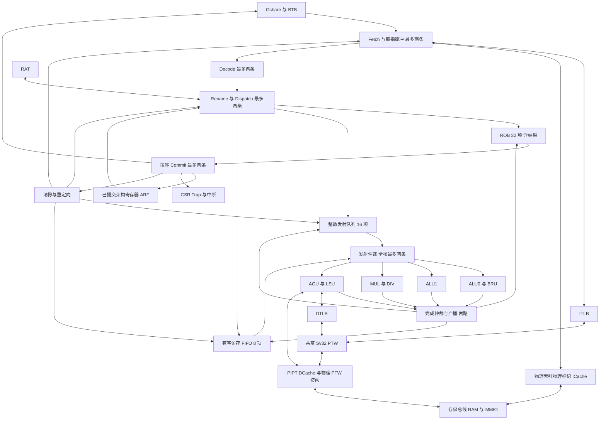

# RISC-V 双发射乱序处理器项目设计书

| 项目 | 内容 |
| --- | --- |
| 课程与项目 | 2026 HIAS 计算机体系结构课程设计；基于 RISC-V 的超标量乱序处理器设计与实现 |
| 文档版本 | v1.8，2026-10-20，纳入 P1-C-R2 复审与 R3 单项收尾任务 |
| 内部开发周期 | 2026-10-19 至 2026-12-31；12 月 20 日功能冻结，最后四天交付缓冲 |
| 课程时间 | 原文暂定二月初考核，具体日期和报送时间待课程通知；12 月底是项目内部目标 |
| 当前状态 | P0/P1-A/P1-B 已验收并合入；P1-C-R2 格式/独立镜像等主要修复接受，R3 仅收尾 fault 负向失败传播，暂不合入/不进入 P1-D/E；完整访存/CSR/Trap、完整差分与 FPGA 未完成 |
| 实现方式 | 自主确定架构与接口，SystemVerilog 实现，AI 辅助开发，分层验证，FPGA 实机演示 |
| 执行协作 | Windows 侧 Codex 管理与审查；Ubuntu 24 容器中的 opencode 实现和测试；用户手动转交任务与报告 |
| 文档边界 | 本文中的参数、日期与覆盖目标是项目基线，均不是已完成结果；待确认课程口径单列管理 |

本项目的首要交付是能够重复验证并在 FPGA 上运行的双发射乱序 CPU，同时完成 Cache/MMU/TLB 和浮点功能实验。实施顺序以架构正确性与课程必选要求为依据：先建立程序执行与退休检查，再完成可扩展的 OoO 核心，随后集成存储系统、预测器和浮点演示。性能优化须有同条件测量结果，不以生成代码数量判断进度。

课程依据为[实验指导书](course/体系结构实验指南-2025秋季.docx)、[课程考核指南](course/课程考核指南.docx)与已核对的[实验要求摘要](course/实验要求.md)。技术依据、资料链接与调研边界见[技术调研记录](research/技术调研-2026-10-19.md)，[用户初步计划书](archive/初步计划书-2026-10-19.md)保留供追溯。

## 1 课程要求与项目范围

### 1.1 必选要求映射

下表中的课程功能实现项均未验收。P0-01 通过证明基础工具与验证路径可用；[P0-02 管理验收](progress/P0-02-R2-review.md)冻结 P1 规格、平台与共享接口，不能替代 CPU/FPGA 功能证据。需求编号用于任务、提交说明和测试报告之间的追溯；阶段定义见第 9 节。

| 编号 | 原文要求与位置 | 本项目实现方案 | 验收证据与阶段 |
| --- | --- | --- | --- |
| C01 | 1.1 架构基础文档 | 总图标注各级宽度；逐模块接口、内部 RTL 框图、时序与恢复规则 | P0 接口基线，P7 最终图文与现场讲解 |
| C02 | 1.1 乱序执行、多个执行单元 | RAT + ROB 结果存储；整数 IQ 动态调度；两个 ALU 及独立长延迟单元 | P2 年轻独立指令先完成、相关指令等待的日志 |
| C03 | 1.1 ROB、发射队列、顺序提交 | 32 项 ROB、16 项整数 IQ，按序退休 | P2/P3 环回、满空、并发与退休序号断言 |
| C04 | 1.1 精确中断，Commit 处理 | 提交边界接收中断，记录准确 EPC，恢复架构状态 | P2/P5 中断注入、使能屏蔽、返回及副作用测试 |
| C05 | 1.1 Fetch/Issue/Commit 至少为 2 | 最终取指、译码、重命名、派遣、全核发射与提交均支持两条 | P3 实际双发射、双提交事件及持续独立指令测试 |
| C06 | 1.1 同周期指令依赖 | 槽间 RAW 旁路、WAW 最新映射、WAR 读值/Tag 固定、x0 处理 | P3 各槽组合、提交同目标与停顿测试 |
| C07 | 1.1 动态 BPU、BTB、准确率要求 | Gshare + BTB；项目以准确率严格高于 70% 作为保守验收门槛 | P4 固定测试集、计数原值、冷启动与稳态报告 |
| C08 | 1.1 错误路径清除与恢复 | 首版在分支提交点进行全量年轻指令清除 | P2/P4 错路访存、迟到响应、恢复后差分测试 |
| C09 | 1.2 多路组相联、Tag/Data 分离并行访问 | 两路 PIPT ICache/DCache，分离阵列同时读出 | P5 结构检查、命中波形、FPGA 存储映射报告 |
| C10 | 1.2 写回、写分配、一种替换算法 | DCache WB/WA，两路精确 LRU | P5 写命中、写缺失、脏替换、字节写及数据保持测试 |
| C11 | 1.2 Sv32 或 Sv39、独立全相联 ITLB/DTLB | Sv32、两级硬件 PTW、各 8 项全相联 TLB | P5 翻译、命中、插入、替换、权限与大页测试 |
| C12 | 1.2 OS Page Fault 处理 | 最小 M/S 监控程序与页表管理程序；指定 OS 口径待确认 | P5 缺页、补页/修改 PTE、SFENCE.VMA、重执行闭环 |
| C13 | 1.3 IEEE 754 加、乘、除及给定数据 | 自主 binary32 Add/Sub/Mul/Div，舍入与特殊值完整覆盖所列算子 | P6 给定数据、SoftFloat 比对、定向与随机记录 |
| C14 | 功能仿真、集成验证 | 模块断言、ISA 测试、退休差分、整机回归 | 各阶段命令、版本、通过/失败数与日志 |
| C15 | FPGA 硬件验证 | 目标板运行测试程序及浮点/中断演示，保存布线后时序与资源报告 | P1 首次上板，P7 最终实机证据；综合不能替代上板 |
| C16 | 基本功能完成后比较 Benchmark IPC | 使用课程指定 Benchmark；领取前采用固定内部测试集 | P7 原始计数、运行区间、编译参数、正确性结果 |
| C17 | 报告、代码清单、成员分工与现场验收 | 可复现打包、五人职责与个人贡献、全部成员参与答辩 | P7 报告 PDF、代码包、文件清单与演示步骤 |

原文“例如 3 个 ALU”不作为固定数量要求。ICache 只读，不将 DCache 的写策略机械应用于 ICache。课程未明确要求 I/D Cache 都独立实现，本项目选择分离结构以便组织双取指和访存。

### 1.2 进阶项与主动增加的范围

| 内容 | 课程定位 | 本项目安排 |
| --- | --- | --- |
| 全统一发射队列 | 进阶 | 首版整数 IQ 与访存 FIFO 分离，不申报此项 |
| RAS、Checkpoint、复杂预测器 | 进阶 | 正确性基线稳定后再评估，不进入当前关键路径 |
| Cache 流水化、Bank、非阻塞等优化 | 进阶 | 首选比较可测量的命中流水化；进度不足可取消优化，不取消 C09/C10 |
| FPU 流水化/并行化与前后对比 | 进阶 | 基本运算通过后优化加/乘路径；除法先采用迭代方案 |
| M 扩展、Zicsr、Zifencei | 项目实现选择 | M 便于 C 程序/Benchmark，CSR/指令同步支撑系统实验，纳入当前基线 |
| FP32 减法、五种舍入模式、异常标志 | 项目明确化目标 | 加减共用主体，预留未来 F 接入，不能代替教师对浮点范围的确认 |
| 完整 RV32F、Linux、A/C/D、调试协议 | 未见统一必选依据 | 暂不列为已承诺范围；若课程新增要求，执行范围与排期变更 |

### 1.3 必须澄清的课程边界

FPU 独立模块、SoC 外设演示是否足够；是否指定 FP32/FP64、舍入模式和测试数据；是否要求完整 F 扩展；MMU 是否使用指定 OS/给定处理器框架；Page Fault 与 TLB 填充预期；指定 Benchmark、预测统计口径与 FPGA 演示项目，均须在 W1 发起确认。

原文中“用特权指令将 PTE 加载进 TLB”的表述不能直接转化为自定义指令要求。根据 [S2](https://docs.riscv.org/reference/isa/v20260120/priv/supervisor.html)，当前选择软件更新内存页表、执行 SFENCE.VMA、硬件 PTW 重新填充 TLB。此选择需与助教核对；最小监控程序也不能预先认定等同于指定 OS 作业。

课程总评为考试 20%、实验 70%、作业 10%；实验指导书内部“验收 70%、报告 50%”存在冲突，待澄清。报告文件名的 2025 与封面 2026 不一致，按后续通知报送。

## 2 调研结论与架构决策

| 决策 | 基线选择 | 依据及代价 |
| --- | --- | --- |
| 重命名与结果保存 | ARF + RAT + data-in-ROB | BOOM 文档说明这是独立于 PRF 的合法设计组织；首版减少空闲表/物理寄存器恢复状态，但 ROB 读端口与广播仍需综合验证 |
| 恢复 | 分支到达 ROB 头后提交并清除年轻指令；异常在提交头处理 | 课程允许提交时恢复；便于从已提交 ARF 重启，代价是分支恢复延迟较大 |
| 访存 | 有序访存 FIFO，单个普通数据请求在途，Store 仅在提交头执行不可逆写入 | 先避免错误的 Load 越过 Store；代价是访存并行性有限 |
| Cache/MMU | 阻塞 PIPT Cache、共享 PTW、保守全量 SFENCE | 先降低别名、失效和在途请求恢复的复杂度，接受额外访存/翻译周期 |
| 参考实现 | Triathlon 看接口与验证，RSD 看 FPGA，SoomRV 看组织与参考模型 | 不继承其测试通过、频率和 IPC；具体来源见调研记录 |
| 浮点验证 | SoftFloat 3e + TestFloat + 专项难例 | TestFloat 作者说明常规生成不能充分覆盖除法困难舍入，需要补充测试 |
| 架构验证 | Spike 主差分；ACT 选定版本补充 ISA 覆盖 | 当前 ACT 文档使用 ACT4/UDB/Sail；不照抄旧 RISCOF 流程，不把 ISA 测试当成全部验证 |

Triathlon performance_enhance 分支已确认存在并阅读其项目文档；本次未复现。初稿中的 main 复现结果为待提交证据的历史信息。README 与该分支架构文档的参考模型描述并不完全一致，P0 需基于锁定源码确认实际实现。不得把学习分支或第三方 IP 直接包装为自主设计成果。

## 3 ISA、平台与参数基线

### 3.1 软件可见范围

- 最终目标为 RV32IM + Zicsr + Zifencei，单核、小端、32 个整数寄存器、无压缩指令；初期 RV32I 是开发配置，不是最终已经支持的 ISA 声明。
- 特权实现以规范集合 `v20260120` 的 M/S/U、Sv32 为依据，逐项形成支持表与测试。暂不实现 H、A、C、D、完整 F、Linux 启动及多核一致性。
- 对自然对齐的字节/半字/字访存实现完整读写和符号扩展；非对齐半字/字产生明确的地址非对齐异常；非法指令及不支持的 CSR/权限访问产生相应异常。
- 支持 ECALL、EBREAK、MRET、SRET、SFENCE.VMA；WFI 首版按权限规则检查后作为 NOP。FENCE 保守等待先前访存完成；FENCE.I 采用第 6 节的完整同步流程。
- M 扩展先采用迭代或低吞吐实现，包含除零、带符号溢出及余数规则，不以主机算术的默认异常行为替代 ISA 语义。
- CSR/Trap 是核心架构的一部分；未完成支持表与测试前，不宣称“完整兼容特权规范”。工具链、参考模型与测试按本项目实际支持范围配置。

P0-02 已冻结 [ISA](architecture/isa-support.md)、[CSR](architecture/csr-support.md)、[地址图](architecture/memory-map.md)、[共享接口](interfaces.md)和[退休契约](architecture/retire-contract.md)，具体字段及阶段范围以这些表和管理决策为准。P1 为 RV32I + 六种 Zicsr + 保守 Zifencei、最小 M-mode 同步 Trap/返回；M 仍在 P3。P1 的 SRET/SFENCE.VMA 非法，WFI 按权限检查后 NOP；最终 S/U/Sv32 目标保持。

### 3.2 初始可调参数

| 参数 | 初始方案 | 调整依据 |
| --- | --- | --- |
| Fetch/Decode/Rename/Dispatch | 各最多 2 条/周期 | 开发配置可限制为 1；最终端到端验证宽度为 2 |
| Issue/Commit | 全核各最多 2 条/周期 | LSU 与整数队列共用发射配额；特殊提交可降为单条 |
| ROB | 32 项，保存结果、状态和精确 PC | 与 16 项的小配置共同测试边界；不因调小容量削弱功能 |
| 整数 IQ / 访存 FIFO | 16 项 / 8 项 | IQ 覆盖 ALU、分支、M；FIFO 按程序顺序处理 Load/Store |
| 执行单元 | ALU0/BRU、ALU1、MUL/DIV、AGU/LSU；CSR 在头部串行处理 | ALU0 分支与算术互斥，长延迟单元独立持有结果 |
| 完成广播 | 2 路，带结果保持与公平仲裁 | 任意多个 FU 同拍完成时不能丢结果或长期饿死 |
| BPU | 256 项两位计数器 Gshare，8 位已提交 GHR | 首版不更新推测 GHR，预测时索引随指令保存 |
| BTB | 32 项、直接映射、完整标记 | 逐槽预测并选择最早预测跳转，容量可由冲突测试调整 |
| ICache / DCache | 各 4 KiB、2 路、32 B 行 | 64 组，2 路 LRU；根据目标 FPGA BRAM/时序调整 |
| ITLB / DTLB | 各 8 项、全相联、轮转替换 | 独立查找/失效，替换算法简单但必须有定向证据 |
| 地址宽度 | VA/整数 32 位，翻译结果/内部物理地址 34 位 | 平台不实现的高物理地址必须产生访问故障，禁止静默截断 |
| 页表策略 | 硬件 PTW；4 KiB 页与 4 MiB 大页；Svade；ASIDLEN=0 | 与参考模型配置一致，具体处理见第 6 节 |

不预先承诺 IPC、Fmax 或 FPGA 占用率。最终参数变更必须记录配置、测试覆盖、资源和时序依据；课程要求的宽度不能通过参数调整取消。

### 3.3 最小 SoC

先用片上 RAM 支持程序、数据和页表，避免将 DDR 控制器带入核心正确性的关键路径。建议 RAM 物理基址和复位向量为 `0x80000000`，首轮容量目标 128 KiB，板卡确认后按资源冻结。页表按 4 KiB 对齐，测试与链接脚本均由统一配置生成。

平台提供 UART、测试结果寄存器、64 位计时器/比较寄存器及中断输入；地址、访问宽度、清中断方法在 P0 单独冻结。浮点外设演示预留 MMIO 区。MMIO 为不可缓存、有副作用区域，读和写都只允许在提交头执行，不得被错误路径访问。未实现地址由 PMA 返回访问故障，不把任意非 RAM 地址视为有效外设。

仿真与 FPGA 使用同一地址图和软件。外部总线先采用可替换的简单请求/响应桥，板卡需要时再适配 AXI；纯仿真 C++ 外设不能替代最终要求的 FPGA 硬件。

## 4 处理器微架构

### 4.1 总体数据通路



图中的“最多”是结构能力，不保证每周期达到。RTL 开发时应补充每个模块的内部框图、寄存器边界、完成端口与冲突处理，不能仅用该总图替代 C01。

### 4.2 取指与双槽语义

ICache 命中路径支持一次提供 8 B 对齐指令块，取指缓冲按每条实际 PC 形成最多两个有效槽。无 C 时指令均为四字节；遇到块尾、Cache 行尾、页边界或第二条尚不可用时允许只送一条，并保留后续拼接状态，不能读取越界字后猜测有效性。

每槽携带 PC、指令、预测下一 PC、预测索引、取指异常与请求代次。第一槽预测跳转时，后续顺序槽无效；第二槽预测跳转时保留第一槽。第二槽取指失败只在该槽对应指令真正到达提交头时产生异常，不能覆盖第一槽的正常提交。

前端最多两条的声明必须由两条有效指令被接收的事件证明。仅使用 64 位接口、复制单条指令或计数器加二不构成双取指。

### 4.3 RAT、ROB 与同周期依赖

RAT 为 x1—x31 记录有效位及生产者 Token，x0 恒为零且永不建立映射。ARF 仅保存已提交状态，ROB 保存未提交结果。源操作数按 RAT 指向的 ROB 就绪值、等待 Tag 或 ARF 值确定，在进入队列时固定其值/依赖。

双槽重命名按程序顺序组合处理：先确定槽 0 源，再更新其目标映射，再处理槽 1。槽 1 的 RAW 指向槽 0 的新 Token；同拍 WAW 最终映射指向槽 1；WAR 不改变较老指令已绑定的源。`rd=rs1`、`rd=rs2` 及 x0 均需定向测试。

ROB 和目标队列空间必须一起预留，首版只接受槽 0 或连续两槽，不允许跳过槽 0 单独接受槽 1。空间不足则保持未接收内容稳定；不为尚未接收的指令改变 RAT。初版不依赖“同拍释放并重新分配同一项”来提高吞吐，避免资源旁路错误。

Commit 只在 RAT 当前映射仍等于被提交 Token 时清除该映射；若已有年轻写者则保留。两条同目标提交时，ARF 保留较年轻结果。入队与 Writeback 同拍时必须捕获广播，否则可能永久等待已经结束的生产者。

### 4.4 动态调度与完成

整数 IQ 以操作数就绪和 FU 可接收为条件，按年龄选择，满足全核每周期最多发射两条的预算；访存 FIFO 只能发射其最老的合格项。LSU 取得一个发射名额时整数侧最多使用另一个。提供公平仲裁，避免访存或长延迟结果饿死。

单发射 OoO 的验收必须使用能够阻塞旧指令的真实长延迟事件，例如 MUL/DIV 或可变存储延迟，证明年轻独立指令提前执行和完成，而退休仍按序。仅改变执行日志顺序或采用固定延迟双 ALU 不足以证明预期能力。

每个 FU 的完成接口都支持背压，结果保持至被接收；两路完成端口不足时使用结果寄存器/队列等待。完成消息携带 ROB 项号、分配代次、结果及异常信息，只有 Token 与有效项匹配时才能更新或唤醒。

ROB 环回、Flush 和长延迟响应可能造成旧项号重新使用，禁止只比较项号。代次计数位宽在 P0 确定，回绕前停止分配并等待所有旧请求排空，不能依赖“概率上不会回绕”。仿真另设 64 位指令序号用于追踪。

### 4.5 提交、分支恢复与精确中断

普通指令只从 ROB 头连续提交，最多两条；槽 0 不可提交则槽 1 不能越过。槽 1 有异常时可先提交正常槽 0，异常项保留至下一拍头部处理。Store、CSR、Fence、特权返回及分支首版均在头部单独完成提交事务，不与年轻槽共同提交。

分支执行时记录真实方向/目标并标记完成。预测错误先记录，等分支到头提交后，以包含该分支正常结果的 ARF 为恢复基准，清空所有年轻 ROB/IQ/访存项及 RAT 映射，重定向到真实下一 PC。首版不在 Execute 阶段提前做局部恢复，因此不需要恢复部分 RAT 历史；这是允许但有性能代价的选择。

同步异常携带 `cause/tval/epc` 到提交头，异常指令不写 ARF、不正常退休，年轻指令不产生架构副作用。CSR 控制器按委托规则更新 M/S Trap 状态并跳转，返回后能够重试或按软件要求跳过。

异步中断经同步/挂起逻辑处理，在提交边界判定使能、权限与优先级，不能由任意 FU 直接修改 PC。已知的头部同步异常优先处理；否则可在当前边界响应中断，本拍不再正常提交，EPC 指向首条未退休指令，ROB 为空时使用记录的架构下一 PC。正在执行的不可取消 Store/MMIO 提交事务先完成并退休，再在下一边界响应。中断条件变化必须有界评估，不能要求整个推测 ROB 完成才响应；测试覆盖连续双提交、空 ROB、长延迟计算和访存等待。

Flush 后允许无副作用的已接受请求完成，但其过期响应不得写回、重新入队或填回已失效的翻译项。错误路径普通 Cache Refills 可保留为微架构状态；错误路径 Store、MMIO 读写和 CSR 更新禁止发生。复位时同样需要处理外部在途事务，不能靠清除内部 valid 假设事务消失。

### 4.6 动态预测的实现边界

Gshare 用每槽 PC 与已提交 GHR 生成索引，计数器复位为弱不跳转；首版不推测修改 GHR。每个取指槽都保存预测时的索引、方向、BTB 命中与有效预测下一 PC，提交时以保存的索引训练实际条件分支，再按真实方向更新 GHR，不能用提交时的新历史重新计算原索引。分支串行提交使首版每周期最多训练一条，预测查找与训练同拍的读写规则须固定。

BTB 完整标记比较后提供目标；未命中时实际取指路径顺序前进，不能把未提供的目标当成有效预测。两槽均预测跳转时选择程序序最早的一条。BRU 校验完整下一 PC，区分方向错与目标错；实际跳转但没有目标也可能导致下一 PC 错误。普通指令若因过期 BTB 表项被错误预测跳转，仍须校验其真实顺序下一 PC，将其作为预测错误项在提交头单独恢复，并使过期项失效，不能只对已译码分支检查恢复。

预测器只用已提交结果训练，取消错误路径更新。首版允许等待 BRU/提交判定，保留其周期代价供性能分析；达到阈值依靠固定测试的实测，不由 Gshare 算法名称保证。

## 5 模块接口与时序约定

### 5.1 通用规则

- 时序模块使用统一时钟，复位释放同步；板级跨时钟/异步输入只在边界处理。P0 固定复位极性、同步要求与上电状态。
- 数据传输仅在时钟边沿 `valid && ready` 时发生；发送方在受阻时保持 valid 与 Payload，不能把一拍脉冲当成可背压响应。
- 双槽接口携带 `slot_valid[1:0]` 和明确的接收数量；槽为程序序连续前缀，不允许部分接受后重复发送已接受槽。
- 接收数量由消费者反向 `prefix_accept_t` 返回；边沿以 valid/ready 和 count 接收前缀，未接受后缀下一拍重排；完整定义见冻结接口。
- 接收、分配、完成和退休分别计数；任何级的 ready 不能未经寄存器/缓冲设计形成组合环路。
- Flush 的作用范围、与同拍完成/入队的优先级必须统一：复位最高，恢复清除次之，常规完成和入队不得复活被清除项。已接受外部事务另按取消协议处理。

### 5.2 接口清单

| 接口 | 主要 Payload | 宽度与约束 |
| --- | --- | --- |
| Fetch → Decode | PC、指令、预测元数据、取指异常、fetch generation | 2 槽；逐槽 PC 与异常，不共享错误标记 |
| Rename → ROB/IQ/访存 FIFO | Token、操作、源值/源 Tag、rd、PC、预测、异常 | 2 槽；原子预留资源，首版最多连续接受两槽 |
| Issue → FU | Token、操作数、操作码、PC/立即数 | 全核最多 2 条；FU ready 后才出队 |
| FU → WB → ROB/队列 | Token、结果、异常、真实下一 PC | 2 条接收；待仲裁结果保持稳定 |
| LSU/Fetch → MMU | VA、Fetch/Load/Store 类型、特权/权限状态、请求 ID | 初版各一路查找；Miss 向共享 PTW 发请求 |
| PTW → DCache | 34 位物理 PTE 地址、读请求 ID | 物理访问，不再翻译；与普通数据请求公平仲裁 |
| Cache → 存储桥 | 物理地址、读写、字节使能、数据、请求 ID | 首版桥内单事务；行传输拆分为受控节拍 |
| Commit → Store/MMIO/CSR | 头部 Token、授权操作、恢复/返回信息 | 首版每次一个不可逆事务，成功响应后退休 |
| Commit/Trap → Frontend/Backend | 原因、重定向 PC、新代次、清除范围 | 首版全量清年轻项，不以“只清前端”完成恢复 |
| Retire/Trap → 验证环境 | 第 8 节退休与 Trap 记录 | 最多两条有序退休；Trap 作为独立事件 |

本表已展开为 `rtl/include/core_config_pkg.sv`、`core_types_pkg.sv` 与 `docs/interfaces.md`，并经 P0-02 包/契约夹具审查。类型定义是共享依赖，修改必须同时审查所有使用者；包能编译不表示使用这些接口的 CPU 已实现。

## 6 LSU、Cache、MMU 与系统软件

### 6.1 保守访存与副作用

所有 Load/Store 依程序序进入访存 FIFO，首版不允许年轻 Load 越过任何未处理的旧 Store；普通 Load 最多一个数据事务在途。整数指令仍可越过等待的访存指令执行，因此不会把整个后端退化为顺序执行。

Store 可预先准备地址和数据并完成翻译/权限检查，但只有该项同时位于 ROB 头与访存头、且检查成功，才能向 DCache 或 MMIO 发出真正写请求。首版写入成功响应与退休组成一个提交事务；本事务完成前不进行 Trap/中断切换。已退休脏数据的后续写回不受年轻指令 Flush 影响。存储桥必须定义失败写入的副作用边界，演示 RAM 的非法地址在写入前检查，不能先写后报错。

MMIO Load 同样可能有读清零等副作用，只能在提交头发出。Cacheable 与 MMIO 属性在物理地址确定后判断；后者不进入 Cache，不被预取或重复执行。首版不实现投机访存、Store-to-Load Forwarding 和内存违反 Replay，后续优化须独立立项。

### 6.2 Cache 基线与一致性

采用 PIPT，先翻译再访问 Cache，以减少虚拟别名处理。Tag 与 Data 阵列在同一请求阶段并行启动，允许 FPGA BRAM 的同步读延迟；不得先比较 Tag 再启动 Data 读取。两路数据读出后按命中结果选择；DCache 用字节使能实现部分写。

Cache FSM 至少区分查找、选择牺牲行、脏行写回、Refill、原请求重试与响应。替换优先无效路，再按 LRU；仅在有效事务成功后更新状态，随机背压不能导致重复替换或重复回复。验证覆盖脏替换与 Refills 冲突、复位/Flush、行首尾、连续写同一字和不同字节。

ICache 需支持两条取指的带宽组织；可用 64 位数据或等效分 Bank 读取，但 Bank 仅作实现手段，是否申报进阶须有独立优化对比。DCache 首版为阻塞式；缓存优化在基本门禁通过后进行。

页表普通 Store 可能停留在 DCache 脏行中。因此 PTW 必须通过同一 DCache 的物理访问入口读取 PTE，不得绕过到旧的外部 RAM。PTW 请求不能排在“正等待 PTW 的 Load 所占住的端口”之后；仲裁只在真正可服务的请求间进行，避免循环等待。

FENCE 等待先前访存有序完成。FENCE.I 首版采用保守全流程：停止新取指、排空先前数据访存、写回 DCache 脏行并等待底层完成、失效 ICache/取指缓冲，再从下一 PC 重新取指；需有代码修改后执行新指令的测试。禁止仅清 ICache 而保留无法被 ICache 看见的脏代码数据。

### 6.3 Sv32 与 TLB

按 [Supervisor 规范](https://docs.riscv.org/reference/isa/v20260120/priv/supervisor.html)实现 Bare/Sv32、两级遍历、4 KiB 页及 4 MiB 大页；保存页级别以匹配 VPN 并拼接正确的物理地址。验证无效 PTE、W=1/R=0、权限不足、大页 PPN 非对齐、遍历物理访问故障及访问类型差异。

ITLB/DTLB 各自全相联，缓存 VPN、PPN、页级别及必要权限/全局信息。基线 ASIDLEN=0，satp ASID 写入按 WARL 读回零，不宣称多地址空间并存。satp 改写以及 SFENCE.VMA 首版都串行化并全量失效两侧 TLB，允许过度失效以简化实现。

采用显式 Svade 策略：A=0，或写入且 D=0 时产生对应 Page Fault，由软件更新内存 PTE 后同步并重试；不悄悄忽略 A/D，也不在首版实现推测 PTE 原子写回。软件可预置 A/D=1 运行普通测试，但不能只测试这种情况。参考模型和能力配置必须选择同一策略。

SFENCE.VMA 先确保较老页表写入对 PTW 可见，再等待/废弃旧 PTW 结果、失效 TLB，并禁止旧响应重新填入。SUM、MXR、U 位、MPRV 和当前特权对权限的影响需列为测试；权限相关 CSR 串行更新后，旧权限下产生的请求不能跨越边界被错误使用。

Sv32 的 PPN 可形成 34 位物理地址；内部比较和缓存 Tag 均保留相应位。FPGA 若只实现较小 RAM，超出 PMA 的地址产生访问故障，不能把高地址折回低地址；仿真必须测试高位不同而低 32 位相同的地址不会混淆。

### 6.4 CSR、Trap 与 Page Fault 软件

P0—P1 确定 CSR 地址、访问权限、WARL/WPRI、复位值及未实现位；至少覆盖 `mstatus/misa/mtvec/mepc/mcause/mtval/mscratch/mie/mip/medeleg/mideleg`、`sstatus/stvec/sepc/scause/stval/sscratch/sie/sip/satp`，并定义 `mstatush`、计数器、身份 CSR、`mcounteren/scounteren` 等必要行为。M/S Trap 向量首版仅支持 Direct，按合法 WARL 规则处理其他 MODE。PMP 首版配置为零项，仍由固定 PMA 限制平台有效地址；此限制须写入参考模型配置。

CSR、特权返回与翻译同步在 ROB 头串行执行，结果与状态更新共同提交；有权限错误时不得先修改 CSR。实现委托、异常状态保存和 MRET/SRET 恢复，明确别名寄存器的访问掩码及中断位来源。

P1 冻结值与策略：misa=`0x40000100`、合法 WARL 写保持固定能力；mstatus=`0x1800`，MPP 只支持 M；EBREAK tval=0。mcycle/minstret 为可写 64 位计数器，异常不计退休；P1 无 U，mcounteren 暂不实现。mip 的 MSIP/MTIP/MEIP 由平台输入维护，未接源绑零，CSR 写不置位。具体读写抑制、掩码、计数与返回规则按 CSR 表实施，不能用恒零计数或跳过全部 CSR 差分代替。

平台仿真 RAM 固定 128 KiB，页表演示预算 `[0x8001a000,0x8001e000)` 共 16 KiB；页表后到栈底的空隙单列，不将其算成可分配页表。最终 OS/板卡容量仍待确认。

首版对 CSR、Fence 和特权返回统一采用保守的年轻指令清除与重取策略：完成头部操作及其架构更新后，从其正确下一 PC 重新开始；翻译/权限改变时同时更新请求代次及必要 TLB 状态。这样可丢弃已在旧权限或旧 satp 下执行的年轻 Load/Fetch。仅让 CSR 在头部执行，却继续提交此前按旧权限执行的年轻结果，是不允许的。

最小系统软件包含 M-mode 启动/中断支撑、S-mode 页表与 Trap 管理、U-mode 权限测试。Page Fault 演示链路为：构建页表并启用 Sv32 → 访问未映射地址 → 验证 cause/EPC/tval → 处理函数分配或选择物理页、修改 PTE → SFENCE.VMA → SRET → 原指令成功重执行。另验证执行权限、只读页和 A/D 故障不会被错误处理成普通缺页。

该软件用于验证硬件闭环，不代表已经满足“在指定 OS 中增加处理函数”的课程解释；W1 若指定软件环境，则以其替换或扩展监控程序并重新评估排期。

## 7 独立浮点部件

### 7.1 运算与接口

独立模块自主实现 binary32 加、减、乘、除；加减共享解析、对阶、尾数运算、规格化与舍入，乘法先采用可综合整数乘法结构，除法先采用可验证的迭代商生成与余数处理。先保证正确性，再考虑 Booth、压缩树和流水化。

请求为 `{op, a[31:0], b[31:0], rm, transaction_id}`，响应为 `{result[31:0], flags[4:0], transaction_id}`，均使用 valid/ready。首版一次一个运算在途；长延迟结果必须保持至被接收。复位、背压、连续请求和除法 Busy 期间请求处理均需定向测试。

项目目标覆盖 RNE、RTZ、RDN、RUP、RMM，输出 NV/DZ/OF/UF/NX。支持正常数、正负零、Infinity、quiet/signaling NaN 和非规格化数；不采用 FTZ/DAZ 简化。运算 NaN 默认采用 RISC-V canonical NaN 方案，signaling NaN 按规则置 NV；按舍入后检测微小性配置软件参考，逐项核对异常标志。非法 rm 的接口处理须明确，不能随机选择模式。

这里声明的是指定 FP32 算子的目标语义，不是实现 IEEE 754 的所有格式与操作，也不是 RV32F 支持声明。未来若接入 F 扩展，需要额外设计浮点架构状态、译码、Load/Store、fcsr、精确标志提交及其余所需操作，不能只接四个算子就宣称 RV32F 完整。

### 7.2 参考与验收

采用固定版本 SoftFloat 3e 逐位比较结果和异常标志；TestFloat 用于生成有分布的用例，另外加入除法困难舍入样例和取消/背压测试。主机 `float` 仅可作辅助检查。NaN 比对策略预先固定，不能在失败后随意屏蔽 payload 或 flags 差异。

内部最低测试目标为每个运算、每个支持舍入模式至少 100,000 组可重复用例，加给定课程数据和全部已列边界类；这是项目测试预算，不是课程原文，也不是穷举证明。先让 RNE 成为模块开发门禁，最终 P6 覆盖全部已承诺模式。保存生成器版本、配置、种子、计数和首个失败输入；问题修复后加入永久回归。

### 7.3 集成与演示边界

独立模块从 W2 开始推进，W5 前达到主要算子 RNE 验收，W7 前完成所列模式与专项测试，W9 进行最终验收。另准备可综合 MMIO 包装，在同一 FPGA 上由整数 CPU 写操作数/控制、轮询结果并检查，作为默认系统演示方案；它是浮点加速外设，不是 F 扩展。

独立模块和 MMIO 演示是否满足课程，须于 W1 向助教确认。未获确认时该验收口径保持高风险，不能自动标绿。若要求完整 RV32F，立即新增独立集成任务、重排五人职责，并撤销进阶性能优化预算；新增范围的完成与否如实记录。

## 8 验证、性能与证据

### 8.1 分层验证

| 层级 | 内容 | 通过条件 |
| --- | --- | --- |
| 静态与综合 | Lint、位宽/锁存器/组合环路、断言启用检查、早期综合 | 无未处理错误；告警逐项解释并审核，不能全局关闭以制造通过 |
| 模块 | Decode/ALU/M、RAT/ROB/IQ、LSU、BPU、Cache、TLB/PTW、FPU | 定向边界、随机背压、Reset/Flush、并发冲突通过；列出功能覆盖点 |
| 程序与 ISA | 全部承诺指令、定向汇编、C 程序、适配后的 ACT | 配置和 ELF 对应；无不明排除项；跳过项须有范围依据 |
| OoO 与差分 | 多写者依赖、双槽、乱序完成、精确 Trap、中断、错路副作用 | 按退休顺序无架构差异，永久断言无失败 |
| 系统 | Cache/MMU/权限/页表更新/中断/FPU 演示 | CPU 发起并运行完整软硬件闭环，独立模块测试不能替代集成结果 |
| FPGA | 同地址图软件、串口签名、计数器、布局布线后时序/资源 | 板上预期结果正确，约束有效且时序满足目标；仅能综合不算完成 |

Verilator 版本由 P0 冒烟测试后锁定，并确认断言实际生效；调研已发现不同版本默认行为存在变化。参考 CPU 的 Verilator 5.008 限制不直接约束自主工程。开发主环境建议固定 Linux/WSL2，FPGA 工具在板卡支持环境运行；记录 OS、工具链、Verilator、参考模型、ACT、SoftFloat 与 EDA 版本/Commit。

### 8.2 退休与 Trap 记录

最多两路退休记录按槽 0、槽 1 顺序送入检查器，每条包含 Token、PC、原指令、架构下一 PC、rd 写使能/编号/结果、特权模式、CSR 读写有效性，以及访存 VA/PA/大小/掩码/数据；全局 seq 仅存在于仿真包装，不进入可综合退休载荷。正常退休与 Trap 同拍互斥；S0 正常、S1 异常时先退休 S0，下一拍输出独立 Trap。Trap 保存触发/返回 PC、cause、tval、目标模式和相关 CSR。

协议为 `hias-retire/2`，参考派生字段和未观测字段显式区分，不伪造 Token/next_pc。Store 数据为按访问宽度截取的低位标量，mask 单独指示 lane；桥返回低位零扩展原始读值，LSU 生成架构符号/零扩展结果供退休记录。正常/Trap/多槽 seq 严格递增，细则见冻结契约。

Spike 先在 P1 接通基本整数退休检查；P0/P1 用微型程序确认可逐步读取所需状态，再扩展到 CSR、Sv32、Svade 和中断。任何模型能力或接口缺口须形成适配任务；NEMU 仅在配置和覆盖足够时作为第二参考，不能无说明切到功能更少的模型。

MMIO 通过统一设备模型或严格限定的显式同步规则比较，每次特殊处理留日志；cycle/time 等非确定值按事先声明的机制处理。中断采用可重复注入并在参考端对齐相同退休边界，同时独立检查 DUT 的挂起/使能/响应规则，不能通过参考端延迟掩盖 DUT 中断错误。禁止 blanket skip CSR、Trap 或 MMU 来得到“DiffTest 全通过”。

### 8.3 核心功能覆盖清单

1. RAW/WAR/WAW、x0、同槽/跨槽读写、同拍提交与重命名、入队遇到完成广播。
2. ROB/IQ/访存队列空满、连续分配与释放、环回、双槽只剩一项空间、长时间背压与公平性。
3. FU 多路同拍完成、结果端口受阻、Flush 后旧 Token 回传、旧内存响应到达、代次回绕排空。
4. 第一/第二槽分支与异常、年轻 Store/MMIO/CSR 被清除、同拍异常与中断、空 ROB 中断、M/S 返回与委托。
5. 两个独立整数执行通路真实并发；长延迟旧指令与年轻指令乱序完成；连续独立整数流实际双提交。
6. Cache 命中/冷缺失/冲突缺失/脏替换、部分写、Refill 背压、FENCE.I 自修改代码。
7. TLB 替换、两级叶、大页、权限、A/D、SFENCE/satp 与旧 PTW 交叉、页表脏数据可见性、34 位 PA 不混叠。
8. 所列 FPU 数值与标志、特殊值组合、除法难舍入、Busy/背压、复位与 MMIO 演示。

永久断言至少覆盖：退休序号严格递增；x0 恒零；未授权 Store/MMIO 不发出；队列计数合法；每指令只完成/退休一次；异常指令不正常退休；被清除 Token 不更新架构状态。用缩小资源配置增加边界命中，不能只运行默认大配置。

P3 稳定基线的内部随机门槛先定为不少于 10 个固定种子、累计 1,000,000 条正常退休指令的差分运行，混合依赖与可变存储延迟。特权、Cache/MMU、FPU 另有专门用例，不以整数随机数目代替。该数量是最低执行预算，所有已知失败必须修复或明确列为未完成，不能以跑够次数作为正确性证明。

### 8.4 性能指标口径

- `IPC = 区间正常退休指令数 / 区间 CPU 周期数`，`CPI` 为其倒数。异常指令、错误路径指令不计正常退休；零退休区间不计算 CPI。保留包括启动的全程数据及标明边界的测量区间，不能混用。
- Fetch/Issue/Commit 分别记录 0/1/2 条周期数，报告双发射与双提交发生次数及利用率；“结构宽度 2”不意味着任意程序 IPC 必须大于 1。
- 方向准确率以已退休条件分支为分母、预测方向正确条数为分子；BTB 缺失仍纳入相关分支统计。另报全部已退休控制转移的下一 PC 准确率、BTB 命中、恢复次数与代价，不用普通指令稀释分母。BHT 方向正确但 BTB 缺失导致实际走错路径时，不能计为下一 PC 预测成功；内部 P4 同时以方向和控制转移下一 PC 准确率高于 70% 为目标，课程正式口径确认后补充相应指标。
- 以同一固定测试清单报告每程序原始计数与汇总，默认包含冷启动；若另报预热结果，列出预热区间，不挑选最好程序宣称达到门槛。课程若另有统计口径，增加相应报告而保留内部统计。
- Cache 报读/写命中、缺失、Refill、脏写回、响应延迟与带宽；TLB 报 ITLB/DTLB 命中、Miss、PTW 周期和 Fault；区分架构访问与推测访问统计。
- FPU 报运算延迟和启动间隔；FPGA 报 LUT/FF/BRAM/DSP、实际时钟、布线后最差时序和未约束路径。IPC、频率与资源共同评估，不用单独的高 IPC 代替实测性能。

优化对比固定 ELF、工具链选项、参数、内存延迟、预测/Cache 初态、测量区间和板卡约束。使用课程指定 Benchmark 前先验证结果签名；无指定材料时的内部结果不称为课程排名。

### 8.5 证据包

每次阶段验收记录：需求编号、RTL Commit 与是否有未提交改动、配置、程序/ELF 哈希、工具版本、复现命令、随机种子、计数、退出码、完整日志及必要波形。综合与上板另记录 FPGA 型号、引脚/时钟约束、bitstream 对应版本、板上输出及运行步骤。

状态区分“已编写”“模块测试通过”“整机集成通过”“FPGA 通过”；缺证据记为未验收。未实现测试框架之前，不写虚构的现成测试命令；P0 建立统一入口后，将实际命令补充进 `docs/verification.md`。

## 9 开发阶段与里程碑

### 9.1 阶段门禁

| 阶段 | 工作范围 | 必须具备的出口证据 |
| --- | --- | --- |
| P0 工程与规格 | 工具链、地址图、ISA/CSR 支持表、接口、测试清单、参考模型适配冒烟 | 测试 ELF 可生成；参考模型可运行；最小 RTL 测试夹具可编译/仿真；不依赖完整 CPU |
| P1 最小顺序核 | RV32I 数据通路、退休接口、基本 M-mode Trap、总线适配、早期综合与上板 | 现有范围全部指令及简单 C 程序通过；基本差分；UART/签名程序首次上板 |
| P2 单发射 OoO | RAT/ROB/IQ、长延迟事件、保守 LSU、提交恢复、精确中断 | 真实乱序完成与顺序提交；依赖/Flush/中断定向通过；整机基本差分 |
| P3 双发射 OoO | 贯通两槽、两路完成、双提交、M 扩展收尾 | C05/C06 实际事件；边界测试与规定随机预算通过；综合资源/时序复核 |
| P4 动态预测 | Gshare/BTB、预测元数据、更新与恢复、准确率统计 | 固定测试集高于 70%；冷启动/方向/目标分别统计；错路恢复回归通过 |
| P5 存储与系统 | I/D Cache、Sv32、分离 TLB、PTW、CSR/权限软件闭环 | C09—C12 全部定向及整机测试；Page Fault 修复后重执行；上板存储冒烟 |
| P6 浮点 | binary32 Add/Sub/Mul/Div、软件参考、指定数据、演示包装 | 所列算子/模式/flags 比对通过，课程接入要求得到满足或如实列缺项 |
| P7 集成与交付 | 功能回归、Benchmark、实机、报告、演示排练 | 最终配置全部必选证据齐全、可复现；成员可解释各自工作 |

P1 保持最小，只保留可复用的 Decode/ALU、存储接口、退休检查和 FPGA 包装；不完整重做单周期、五级流水线和双发射顺序核。共享类型和接口从 P0 按最终双宽度设计，通过限制接收宽度建立单发射配置。

### 9.2 时间表与并行安排

| 周次 | 日期 | 核心关键路径 | 存储、浮点与验证并行工作 | 周末验收 |
| --- | --- | --- | --- | --- |
| W1 | 10/19—10/25 | P0 规格、接口、工具与验证骨架 | 锁定板卡/领取安排；课程疑问；FPU 参考模型；Cache/PTW 接口 | 工具和规格基线，不宣称 CPU 已运行 |
| W2 | 10/26—11/01 | P1 最小顺序核、退休差分、基本 Trap | Cache/FPU 单元开发；板级时钟/复位/RAM/UART，首次综合与上板 | RV32I 程序基线，首次硬件结果 |
| W3 | 11/02—11/08 | P2 Rename/ROB/IQ、长延迟执行 | M/S 软件与 CSR 测试；Cache/FPU 定向；共享 PTW 原型 | 单发射 OoO 原型与依赖日志 |
| W4 | 11/09—11/15 | P2 恢复、中断、保守访存；开始 P3 | Cache 模块门禁，MMU/权限定向，FPU 随机比对 | OoO 正确性门禁，不带失败跨阶段 |
| W5 | 11/16—11/22 | P3 双发射、双提交、M 与综合复核 | P4 Gshare/BTB 集成；FPU 主算子 RNE 门禁；系统软件推进 | 稳定 2-wide 基线与随机差分 |
| W6 | 11/23—11/29 | P4 验收，P5 I/D Cache 集成 | PTW/ITLB/DTLB，Svade/权限/异常；FPU 模式扩充 | BPU 统计、Cache 整机结果 |
| W7 | 11/30—12/06 | P5 Sv32 与软硬件闭环 | FPU 主要语义完成，MMIO 包装；Cache/MMU 上板冒烟 | 缺页修复重执行、关键系统回归 |
| W8 | 12/07—12/13 | P5 全部边界、整机恢复与存储回归 | P6 给定测试及困难舍入；报告图文、综合资源修正 | 存储系统完整门禁，禁止大规模重构 |
| W9 | 12/14—12/20 | P6 最终验收，整机回归与性能 | 最终 FPGA 系统演示、必要进阶对比、报告 | 必选功能冻结，缺项有明确结论 |
| W10 | 12/21—12/27 | P7 修复、布线后时序与实机复测 | 证据包、报告 PDF、五人演示排练 | 最终候选版本 |
| 缓冲 | 12/28—12/31 | 只修复交付阻塞问题 | 重复关键测试、校验代码包与报告对应 | 内部正式交付 |

以上是五人协作、核心接口提前约定的目标计划。FPU 不等到 W9 才开始；CSR/异常不等到 MMU 集成才补。实际人力若少于计划，W1 必须重新估计吞吐与并行任务，不能假设 AI 自动补足全部工作量。

### 9.3 路线调整触发条件

- 10/25：板卡、FPU/OS 口径仍未确定时登记高风险并由组长跟进；不能把未知项移出必选范围。若板卡暂未发放，保留综合与板级包装工作，并明确首次实机节点受阻。
- 11/15：单发射 OoO 依赖、恢复或中断仍存在重大错误时，冻结非必要优化，集中修复 P2；其他成员继续模块验证，暂缓有风险的整机合入。
- 11/29：双发射/Cache 尚无稳定基线时，取消 RAS、Checkpoint、非阻塞 Cache 和性能型重构，提交按实际剩余工作重排的日期表；不得以退回单发射冒充 C05 完成。
- 12/13：Page Fault 软件闭环、存储系统恢复和 FPGA 核心运行任一未通过，停止新增进阶功能，将其列为交付阻塞；不得只展示独立 MMU 模块即认定 P5 通过。
- 12/20：冻结功能与配置。剩余必选缺项单列，优先修复；若无法按内部目标完成，明确申请调整内部交付或记录课程缺项，不虚构完成状态。

任一门禁不通过均保存失败证据、负责人、修复任务和复验日期。只有存在可执行的独立任务时才并行推进，不能用同时堆叠更多模块掩盖关键路径故障。

## 10 分工、提交检查与 AI 使用

执行协作按[协作流程](协作流程.md)进行。管理方在 Windows 侧阅读要求、设计与提交证据并调整路线；RTL、软件、构建与实际测试由 Ubuntu 24 容器中的 opencode 完成。用户负责手动转交任务和报告位置，当前不具备自动派发或持续监控。P0/P1-A/P1-B 已验收，P1-C-R2 主要修复已接受、仅剩 fault 负向失败传播，当前下达 [P1-C-R3](tasks/P1-C-R3-fault探针失败传播.md)，整体验收后再完成 P1-D—G；子集差分不等于完整 P1 完成。

### 10.1 五人职责模板

课程要求每组五人；以下 A—E 为待替换的角色标识，尚非实际人员分工。W1 将姓名、可用工时与替补关系写入进度记录。

| 角色 | 主责 | 必须参与的交叉检查 |
| --- | --- | --- |
| A 组长与后端 | 架构、RAT/ROB/Commit、范围与进度 | B 的双槽依赖，E 的退休/Trap 记录 |
| B 前端与调度 | Fetch/Decode、IQ、ALU/BRU、Gshare/BTB | A 的恢复契约、C 的取指异常 |
| C 存储与系统 | LSU、Cache、TLB/PTW、M/S 软件与权限 | E 的页表闭环、D 的 MMIO 约束；任务量高，E 在系统阶段共同承担软件 |
| D 浮点与长延迟单元 | FPU、MUL/DIV、参考向量、浮点演示 | FU 背压与 Token、异常/舍入覆盖 |
| E 验证与 FPGA | 构建、参考模型、回归、平台外设/约束、证据 | 各模块测试设计、系统软件、报告可复现性 |

每人对自己的设计、测试和报告部分负责并能现场解释。验证不是只由 E 在结尾执行；模块负责人必须交付相应测试，E 负责统一环境与交叉验证。

### 10.2 每次提交的检查

任务先说明需求编号、允许修改的范围、接口、测试和完成标准；接口更改先评估调用者，再修改实现。提交包含设计说明、适用配置、复现命令、结果与已知限制。开发流程为：规格/测试设计 → 实现 → 静态检查 → 模块测试 → 相关整机回归 → 审查 → 合入。

模块提交不要求等待未相关功能全部实现，但不能破坏已建立的稳定基线。合入主分支前运行当前已经具备且与改动相关的完整门禁；新增测试失败时先定位，不随意删除、跳过或修改期望值。问题修复必须说明根因与验证依据。

管理检查结论分为“通过”“补证据后复核”“存在缺陷需修复”“需求未满足/范围需调整”。每项结论引用 Commit、配置和日志。文档提交只验收文档质量，不因此把 P0/RTL 功能标为完成。

### 10.3 AI 与开源边界

两份课程原文未见明确 AI 政策，本项目拟采用 AI 辅助，不能将其写成课程明确鼓励或已经批准。团队负责规格、审查、测试及解释；AI 生成 RTL 与人工代码按同一质量门禁处理，修改后重新运行相关验证。

参考来源记录仓库 URL、Commit、许可证、查看/复用文件、修改范围与对应自主设计。许可证允许使用不等于课程允许照搬；若涉及直接复用自研考核部分，先取得明确课程口径。HardFloat 可用于交叉参考，当前不作为自主 FPU 的直接替代。

学习参考工程与正式自主 RTL 分开保存，不把整套第三方 CPU 合并进正式工程。功能复现结果只归属于其准确分支/Commit，不跨分支借用。每个阶段通过后记录稳定 Tag，分支、代码、配置和证据共同可追溯。

### 10.4 目录与进度记录

后续目录按实际开发逐步建立，禁止仅创建空目录便登记功能完成：

```text
rtl/                  include、frontend、backend、lsu、cache、mmu、fpu、soc
verification/         unit、isa、difftest、system、regression
software/             startup、runtime、traps、vm-tests、benchmarks
fpga/                 board 配置、约束、构建及实机运行说明
scripts/              统一构建、回归、结果整理入口
docs/                 本设计书、interfaces、verification、course、research
docs/progress/        周记录、决策变更、问题与验收索引
```

周记录列出计划/实际门禁、证据位置、下周任务、风险和负责人；重大接口/范围决定单独记录原因、替代方案、验证影响与回退方式。没有定时监控配置时，检查发生在实际提交或检查请求到来后，不宣称已自动持续检查。

## 11 风险与待决事项

| 编号 | 风险或待决事项 | 负责人/目标时间 | 处置及影响 |
| --- | --- | --- | --- |
| Q01 | FPU 接入、格式、测试范围未知 | 组长 + D，10/25 | 确认独立/MMIO 是否可验收；若要求 RV32F，新增完整范围与工期，不自动降级 |
| Q02 | 指定 OS、处理器框架、TLB 填充口径未知 | 组长 + C，10/25 | 提交标准 Sv32/PTW/软件方案说明；按课程回复修订软件与特权范围 |
| Q03 | 板卡型号、领取时间、EDA 许可未知 | E，10/25；最迟 W2 落实路径 | 获取器件/板图/约束，确认 BRAM/DSP 与时钟；上板必选风险不可删除 |
| Q04 | 实际五人名单、投入与职责未知 | 组长，10/25 | 录入工时与交叉复核，存储与系统软件由 C/E 共同承担 |
| Q05 | Benchmark、给定浮点数据、验收项目未知 | E + D，10/25 发起 | 内部集先固定；正式材料收到后补充回归，保留两者区别 |
| Q06 | 年份、具体日期、实验内部比例冲突 | 组长，W1 发起 | 保存助教回复，按最新通知修订，不自行推算成绩或报送日期 |
| Q07 | AI 与第三方源码使用边界未明确 | 组长，全程 | 自主设计、来源记录、个人理解；新增课程规则优先执行 |
| R01 | 双槽依赖、Token 复用、恢复易出隐蔽错 | A/B，P2/P3 | 定向 + 断言 + 缩小参数 + 延迟响应；失败不进入性能优化 |
| R02 | LSU/PTW/Cache 环形等待与页表不一致 | C/E，P5 前 | 请求拥有权和公平仲裁先定；PTW 走同一 DCache；注入背压检验活性 |
| R03 | FPU 除法舍入与非规格化错误 | D，P6 前 | 软件参考、难例、flags 逐位比对，禁止 FTZ 隐性简化 |
| R04 | FPGA 多端口结构与时序不可接受 | A/E，每阶段 | 早综合、资源配置缩放、必要流水级；保持最终双宽度能力 |
| R05 | 参考模型配置不匹配造成假通过/假失败 | E，P0—P5 | 锁定 ISA/权限/Svade/PMA/设备模型，明确不确定值处理与排除项 |
| R06 | 将参考文档宣称当作本项目成绩 | 全员，全程 | 不重用频率/IPC/测试通过数字；验收只能引用本项目版本证据 |

所有“待确认”都应有跟进记录；超过目标日期就更新风险与排期。未答复不能被视为批准，也不能阻止与该答复无关的规格、模块测试和工具准备工作继续。

## 12 最终交付与本次修订

最终交付包括自主 RTL、软件/页表测试、模块与整机验证、性能原始记录、FPGA 约束/构建/资源/时序/实机记录、数据通路与内部模块框图、接口说明、报告 PDF、个人贡献及参考/AI 使用记录。打包前按 C01—C17 逐项核对并列出所有未完成或未验证内容。

代码包应从最终版本在记录环境下重建关键程序和仿真，报告数据与对应 Commit/配置一致，五人按课程要求到场。最终课程材料按最新命名和邮箱通知由组内报送；本次 Git 文档提交不等于已向助教发送课程成果，也不包含此类邮件操作。

相对初稿，本版主要改动为：建立课程要求编号与证据映射；将 FPGA 改为明确必选；单列精确中断和 OS 缺页闭环；明确 data-in-ROB、提交恢复和有序访存；补充同拍依赖、旧响应、PTW/Cache 一致性及 34 位 PA；将 CSR、FPU 和上板前置；区分独立 FPU 与 RV32F；修正测试框架、AI 政策、课程日期与评分表述；为未知口径设置负责人和决策期限。

本文与 P0-02 冻结细则共同作为 P1 的实施输入。P0/P1-A 已按提交及证据通过管理验收，接下来以实际模块/整机/FPGA 证据推进。取消事务与 Token 回绕的联合补测已由 P1-A 完成；RAM 边界、背压、实际写事件和主机失败传播有模块证据，真实前端与后端仍待实现。课程未决口径保持待确认，不把规格或模块验收视为整机功能完成。
